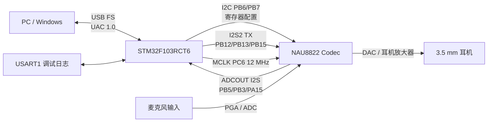
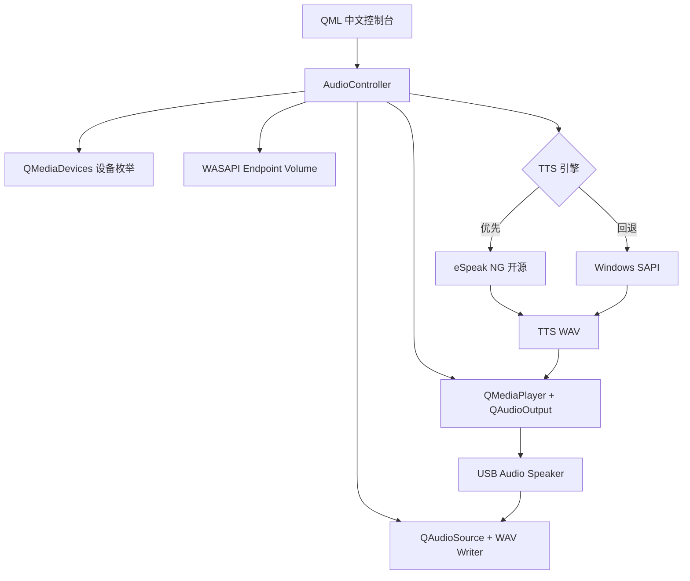
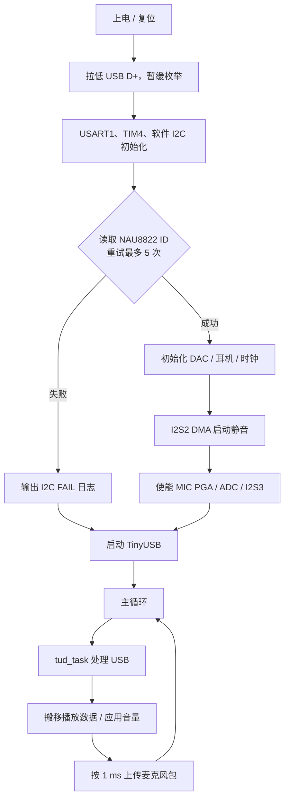
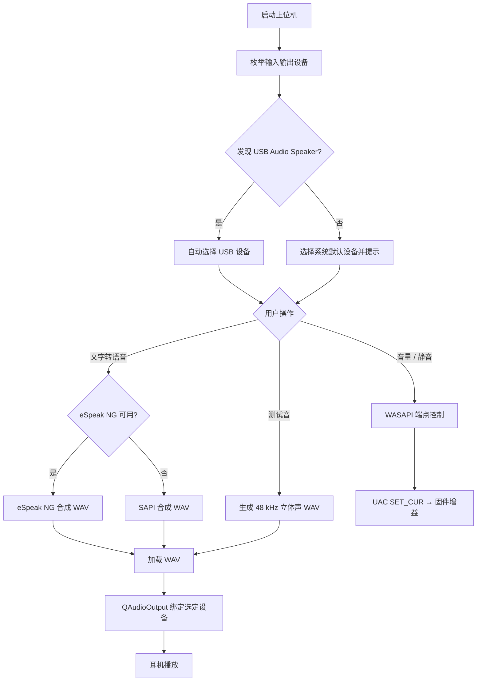
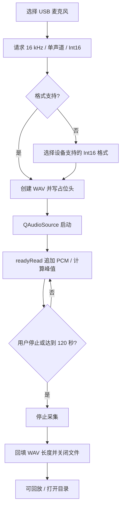

# USB AUDIO SPEAKER 声卡设备设计文档

## 1. 项目概述

### 1.1 功能描述

本项目以 STM32F103RCT6 为主控、NAU8822 兼容 Codec 为音频编解码器，实现标准 USB Audio Class 1.0 声卡。电脑无需厂商驱动即可识别播放和录音设备；PC 音乐经 USB 等时传输进入 STM32，再由 I²S 和 Codec 从耳机口输出。麦克风模拟信号经 Codec ADC 和 STM32 I²S3 采集，重采样后通过 USB 上传。

配套 Qt 6 上位机提供设备识别、播放测试、录音与回放、音量与静音控制、文字转语音功能。文字转语音采用离线方案，优先调用开源 eSpeak NG，未安装时使用 Windows System.Speech / SAPI。

### 1.2 考核要求对应

| 考核项 | 项目实现 | 验收方法 |
|---|---|---|
| USB 枚举声卡（10 分） | TinyUSB UAC 1.0，AC + 播放 AS + 麦克风 AS 三接口 | Windows 设备管理器与声音设置 |
| NAU8822 播放与录音（20 分） | 软件 I²C 寄存器配置，DAC/耳机与 ADC/PGA/MICBIAS 通路 | 串口 ID、耳机输出、录音波形 |
| USB 音频输出（30 分） | 等时 OUT + 环形缓冲 + DMA 双缓冲 + 插值重采样 | 连续播放音乐，观察卡顿、爆音 |
| USB 音量（10 分） | Feature Unit 静音/音量请求，Q15 数字增益 | 系统或上位机滑块调节 |
| 上位机语音交互（10 分） | Qt 控制台，离线 TTS 从指定 USB 声卡播放 | 输入中英文并朗读 |
| 文档（15 分） | 功能、设计、框图、流程、测试与排障 | 本文档 |
| 源码（5 分） | 模块划分、关键路径注释、构建脚本 | 查看固件和 Qt 源码 |

## 2. 总体设计思路

系统采用“标准协议 + 双时钟解耦 + 主机离线合成”的方案：

1. **标准协议**：固件只实现 UAC 1.0，不设计私有音频驱动。Windows 自带 usbaudio.sys 即可完成播放、录音和音量请求。
2. **双时钟解耦**：USB 主机按 48 kHz 发数据，STM32F103 在 72 MHz 主频下采用整数分频得到 46.875 kHz I²S。通过环形缓冲吸收短期抖动，通过线性插值重采样消除长期速率差。
3. **中断与主循环分工**：DMA 中断只处理音频半区，TinyUSB 在主循环运行；软件 I²C 不在 USB 中断内执行，避免破坏 1 ms 等时节奏。
4. **上位机与合成解耦**：TTS 先生成 WAV，再由 Qt 播放到选定的 USB 输出端点，避免合成引擎把声音送到系统默认扬声器。
5. **音量真实生效**：上位机使用 WASAPI Endpoint Volume 控制系统声卡端点。UAC 驱动向固件 Feature Unit 发 SET_CUR，固件将 dB 值映射为 Q15 增益并作用于 PCM。

## 3. 硬件原理框图



### 3.1 关键引脚

| 功能 | STM32 | Codec / 说明 |
|---|---|---|
| 软件 I²C SCL | PB6 | SCLK，开漏上拉 |
| 软件 I²C SDA | PB7 | SDIO，开漏上拉 |
| I²S2 WS | PB12 | LRCLK，约 46.875 kHz |
| I²S2 CK | PB13 | BCLK |
| I²S2 SD | PB15 | DACIN |
| I²S2 MCK | PC6 | MCLK，12 MHz |
| I²S3 SD | PB5 | ADCOUT |
| I²S3 CK | PB3 | 与 Codec BCLK 同网络 |
| I²S3 WS | PA15 | 与 Codec LRCLK 同网络 |
| USB D− / D+ | PA11 / PA12 | 全速 USB |
| 调试串口 | USART1 | 921600 8N1 |

## 4. 固件设计

### 4.1 模块职责

| 文件 | 职责 |
|---|---|
| `User/main.c` | 上电顺序、Codec 检测、音频链路和 USB 启动 |
| `hardware/I2C.c` | 软件 I²C、NAU8822 读写、DAC/ADC/音量配置 |
| `hardware/i2s.c` | I²S2 主发送、DMA 双缓冲、静音与欠载处理 |
| `hardware/i2s3.c` | I²S3 从接收、DMA 双缓冲、左声道读取 |
| `hardware/TinyUSB/usb_descriptors.c` | 设备、配置、AC/AS、端点和字符串描述符 |
| `hardware/TinyUSB/usb_audio.c` | 环形缓冲、重采样、UAC 控制、USB 收发任务 |
| `hardware/TinyUSB/tusb_config.h` | 音频端点、FIFO、麦克风和 PMA 配置 |

### 4.2 USB 描述符

- VID/PID：`0xCafe / 0x4002`。
- 产品字符串：`USB Audio Speaker (NAU88C22)`。
- Interface 0：AudioControl，包含输入终端、Feature Unit、扬声器输出终端、麦克风输入终端和 USB 流输出终端。
- Interface 1：扬声器 AudioStreaming，alt 0 无端点，alt 1 使用等时 OUT `0x01`。
- 播放格式：48 kHz / 16 bit / 2 声道，1 ms 每包 192 字节。
- Interface 2：麦克风 AudioStreaming，alt 1 使用等时 IN `0x82`。
- 录音格式：16 kHz / 16 bit / 单声道，1 ms 每包 32 字节。
- 配置描述符总长度 184 字节，代码中使用编译期断言检查实际数组长度。

### 4.3 播放数据通路

```text
PC PCM 48 kHz
  → USB 等时 OUT（192 B/ms）
  → TinyUSB FIFO
  → 1024 帧环形缓冲
  → 48 kHz → 46.875 kHz 线性插值
  → Q15 数字音量
  → I²S2 DMA 双缓冲
  → NAU8822 DAC / Mixer / Headphone
  → 耳机口
```

STM32 的采样率计算为：

```text
Fs = 72 MHz / (32 × 6 × 8) = 46875 Hz
MCLK = 256 × Fs = 12 MHz
```

重采样步进为：

```text
48000 / 46875 = 1.024
Q16 步进 = 67109
```

读指针每输出一帧前进 1.024 个输入帧。相邻样本间线性插值避免直接丢帧形成周期性阶跃。环形缓冲起播水位为 256 帧，欠载补静音，避免旧数据重复形成嗡声。

### 4.4 录音数据通路

```text
麦克风 → MICBIAS / PGA(+18 dB) / ADC
  → ADCOUT / I²S3 DMA（46.875 kHz）
  → 左声道样本池
  → 最近邻重采样到 16 kHz
  → USB 等时 IN（32 B/ms）
  → Qt QAudioSource
  → PCM WAV 文件
```

I²S3 使用 DMA2 Channel 1 循环双缓冲。PA15、PB3 默认属于 JTAG，因此初始化时关闭 JTAG、保留 SWD，不影响 ST-Link 下载调试。

### 4.5 音量与静音

Feature Unit 主通道和左右声道均声明 Mute 与 Volume。音量范围为 −96 dB 到 0 dB，单位为 1/256 dB。固件收到 `SET_CUR` 后：

1. 缓存主机请求的 dB 值并置更新标志。
2. 主循环把整数 dB 映射为 49 档 Q15 增益。
3. 对重采样后的左右声道 PCM 乘增益；静音直接将数字增益清零。
4. 运行中不写 NAU8822 模拟音量寄存器，Codec 增益只在初始化时设置一次。

这样既保证音量真实生效，也避免拖动滑块时软件 I²C 阻塞和模拟增益级突变引起“哔”声、爆音或卡顿。

## 5. 上位机设计

### 5.1 技术选型

- Qt 6 Quick / QML：界面和设备状态绑定。
- Qt Multimedia：音频设备枚举、QMediaPlayer 播放、QAudioSource 录音。
- WASAPI Endpoint Volume：Windows 端点音量与静音。
- eSpeak NG：可选开源离线语音合成。
- Windows System.Speech / SAPI：无额外安装时的离线合成回退。
- PCM WAV：统一承载测试音、TTS 与录音，便于跨模块验证。

### 5.2 上位机原理框图



### 5.3 关键设计决策

- 下拉框保留所有系统音频设备，同时优先选中名称含 `USB Audio`、`NAU88` 的设备，便于比较排障。
- TTS 不直接调用引擎扬声器输出，而是统一生成文件后交给 QMediaPlayer，确保输出设备可控。
- 录音优先请求 16 kHz / 单声道 / Int16；不支持时采用设备支持的其他 Int16 格式，并在界面显示实际参数。
- WAV 头在录音开始时写入占位长度，停止时按实际数据字节数回填 RIFF 和 data 长度。
- 单次录音限制 120 秒，防止误操作长期占用磁盘。
- 音量优先使用系统端点；不支持 WASAPI 的平台回退为 QAudioOutput 软件音量。

## 6. 软件流程图

### 6.1 固件主流程



### 6.2 上位机播放与 TTS 流程



### 6.3 录音流程



## 7. 构建与运行

### 7.1 固件

1. 使用 Keil µVision 打开 `firmware/Project.uvprojx`。
2. 确认 `ENABLE_USB_MIC = 1`。
3. Rebuild，烧录 `Objects/Project.hex`。
4. 打开 USART1 日志，复位后应出现 I²C ID、I²S 和 USB 启动信息。

本机命令行构建结果：`0 Error(s), 470 Warning(s)`。告警主要来自标准外设库和 TinyUSB 的 C11、类型转换、结构体填充检查，未出现链接错误。完整日志见 `firmware/build_firmware.log`。

### 7.2 上位机

Qt Creator 打开 `USBAUDIOSPEAKER/CMakeLists.txt`，选择 Desktop Qt MinGW 套件后构建运行。CMake 依赖为 Quick、QuickControls2、Multimedia；Windows 额外链接 ole32、uuid。

发布包位于 `USBAUDIOSPEAKER/dist/`，已包含 Qt 运行库，直接运行其中的 `appUSBAUDIOSPEAKER.exe`。

## 8. 实物验收清单

### 8.1 枚举与 Codec

- [ ] 设备管理器无未知设备或黄色感叹号。
- [ ] Windows 声音设置出现 USB Audio Speaker 播放和录音设备。
- [ ] 串口显示 `NAU8822 I2C OK`，ID 与器件匹配。
- [ ] 播放格式为 48 kHz / 16 bit / 立体声，录音格式为 16 kHz / 16 bit / 单声道。

### 8.2 播放与音量

- [ ] 上位机测试音四个音符清晰，无周期性哒哒声。
- [ ] 连续播放音乐 10 分钟，无明显卡顿、重复旧缓冲或持续底噪。
- [ ] 系统音量从 0 到 100 调节，耳机响度真实变化。
- [ ] 静音后无声，取消静音恢复。
- [ ] 暂停、切歌和停止时不会输出旧数据或本地测试音。

### 8.3 录音

- [ ] ADCOUT、BCLK、LRCLK 三根线连接正确且共地。
- [ ] 上位机开始录音后，输入电平随讲话变化，不是一直为 0。
- [ ] 停止后 WAV 可播放，时长与录音时间基本一致。
- [ ] 串口未出现 `I2S3 no data`；若出现，优先检查接线和 JTAG 复用。
- [ ] 若耳机线控与 MICBIAS 冲突，改用不带线控的耳机或独立麦克风验证。

### 8.4 上位机与 TTS

- [ ] 刷新后自动优先选择 USB 声卡。
- [ ] TTS 声音来自 USB 耳机，而不是电脑默认扬声器。
- [ ] 未安装 eSpeak NG 时 SAPI 仍能离线合成。
- [ ] 安装 eSpeak NG 后界面显示开源引擎，支持语速调节。
- [ ] 最近录音可回放，录音目录可正常打开。

## 9. 常见故障定位

| 现象 | 优先检查 |
|---|---|
| USB 无法枚举 | PA11/PA12、48 MHz USB 时钟、描述符长度、PMA 是否超 512 字节 |
| 枚举成功但无声 | Codec ID、I²S 引脚、DAC/Mixer/Headphone 寄存器、是否开流 |
| 周期性爆音 | 重采样步进、环形缓冲指针、主循环阻塞日志 |
| 录音全静音 | `ENABLE_USB_MIC`、三根 I²S3 线、MICBIAS/PGA/ADC、电源共地 |
| 录音有直流偏置 | NAU8822 ADC 高通滤波 R14 |
| 音量滑块无效 | Feature Unit ID=2、bmaControls=0x03、SET_CUR 日志、Q15 增益 |
| TTS 跑到其他扬声器 | 上位机输出设备是否选中 USB Audio Speaker |
| TTS 中文不自然 | 安装中文 SAPI 语音或 eSpeak NG，调整语速 |

## 10. 当前验证边界

软件构建、QML 启动和 SAPI WAV 合成已验证；当前环境没有连接实物，因此不能宣称已经完成 USB 枚举、模拟音质、录音有效波形和音量端到端实测。交付时应按第 8 节逐项上板，并补充设备管理器、上位机运行和录音波形截图作为验收证据。
